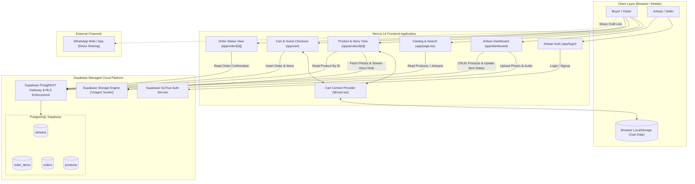
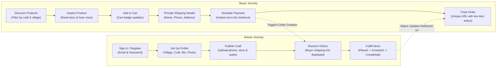
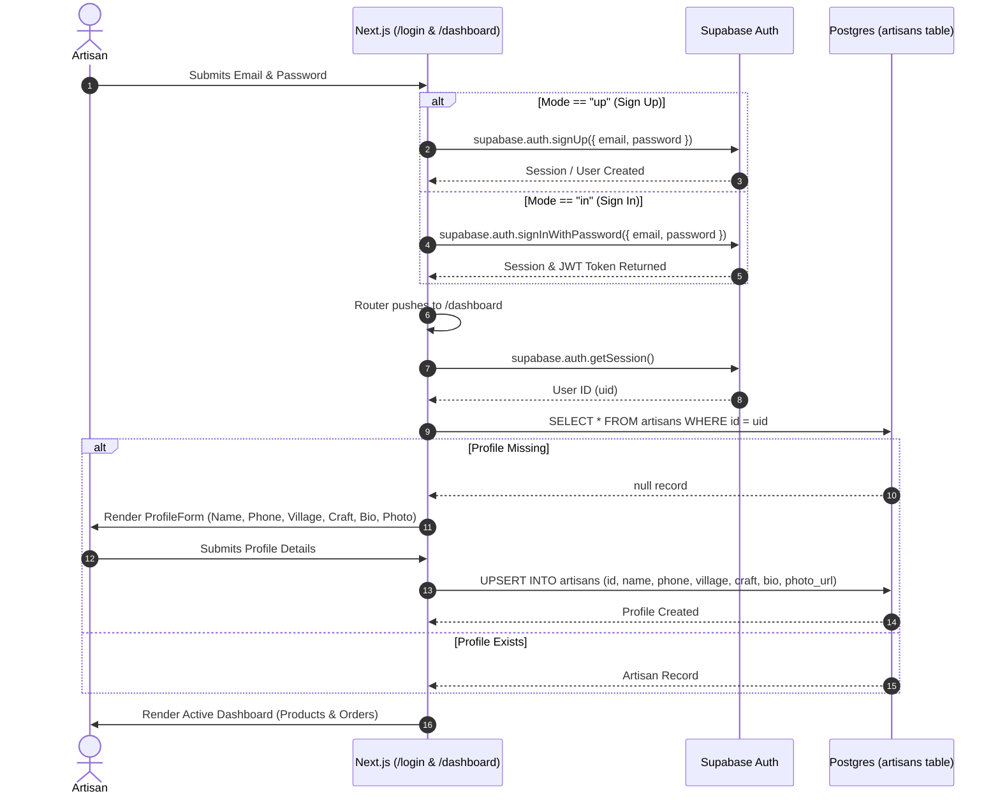
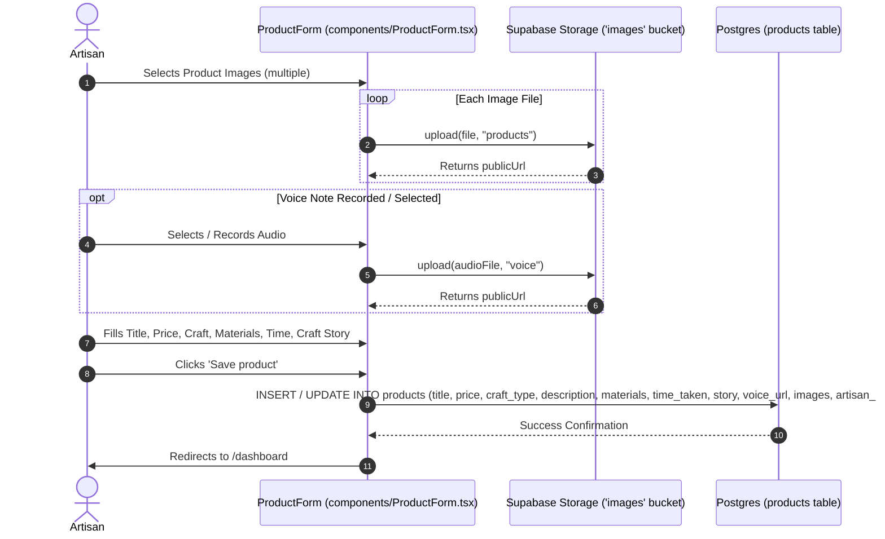
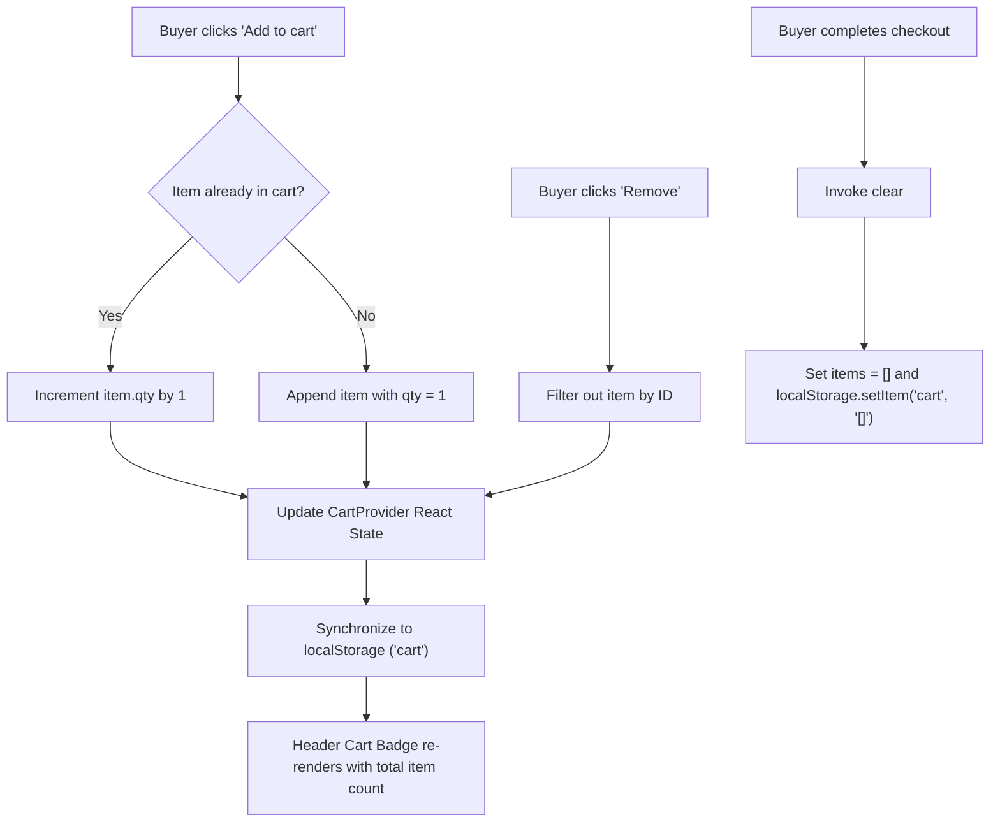
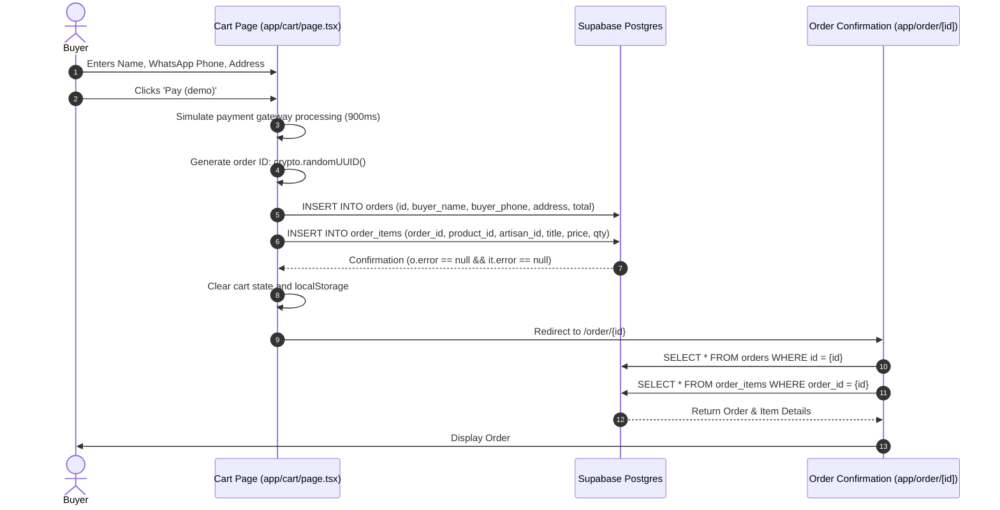
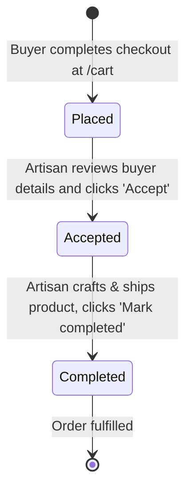
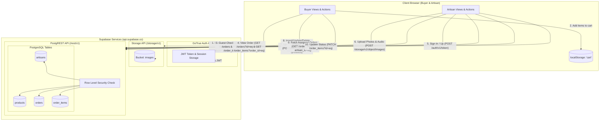
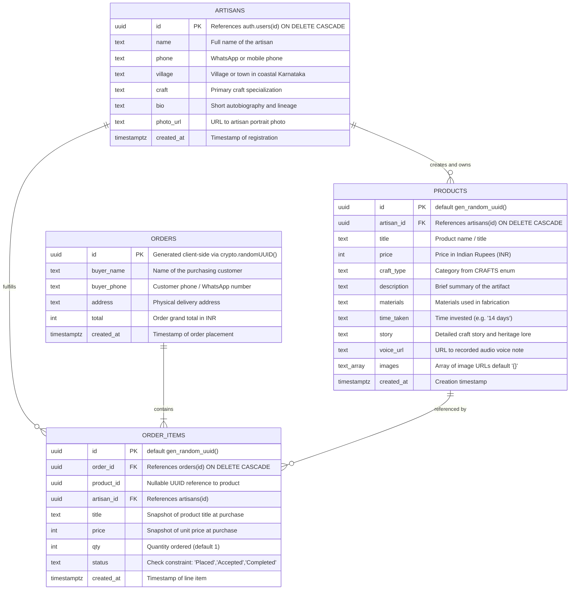

# KaustiKart (ಕೌಸ್ತಿಕಾರ್ಟ್)

> **Direct-from-artisan marketplace connecting the traditional craftspeople of Coastal Karnataka with buyers worldwide — featuring cultural storytelling and authentic voice notes.**

[](https://nextjs.org/)
[](https://react.dev/)
[](https://www.typescriptlang.org/)
[](https://tailwindcss.com/)
[](https://supabase.com/)
[](#24-license)

---

## 2. Table of Contents

- [1. Project Title and Introduction](#kaustikart-ಕೌಸ್ತಿಕಾರ್ಟ್)
- [2. Table of Contents](#2-table-of-contents)
- [3. Project Overview](#3-project-overview)
  - [Background & Motivation](#background--motivation)
  - [Problem Statement](#problem-statement)
  - [The Solution](#the-solution)
  - [Objectives & Expected Benefits](#objectives--expected-benefits)
  - [Scope of the Application](#scope-of-the-application)
- [4. Features and Functionalities](#4-features-and-functionalities)
  - [Implemented Features](#implemented-features)
  - [Partially Implemented Features](#partially-implemented-features)
  - [Planned Enhancements](#planned-enhancements)
- [5. Technology Stack](#5-technology-stack)
- [6. System Architecture](#6-system-architecture)
  - [Architecture Overview](#architecture-overview)
  - [Required Diagram A — High-Level System Architecture](#required-diagram-a--high-level-system-architecture)
- [7. Application Workflow](#7-application-workflow)
  - [Required Diagram B — Overall Application Workflow](#required-diagram-b--overall-application-workflow)
- [8. User Workflow](#8-user-workflow)
  - [Required Diagram C — End-to-End User Journey](#required-diagram-c--end-to-end-user-journey)
- [9. Feature-Specific Workflows](#9-feature-specific-workflows)
  - [A. Artisan Authentication & Onboarding](#a-artisan-authentication--onboarding)
  - [B. Product Creation & Media Upload](#b-product-creation--media-upload)
  - [C. Shopping Cart Management & Persistence](#c-shopping-cart-management--persistence)
  - [D. Guest Checkout & Order Processing](#d-guest-checkout--order-processing)
  - [E. Payment Workflow (Current Mock vs Planned Gateway)](#e-payment-workflow-current-mock-vs-planned-gateway)
  - [F. Artisan Order Fulfillment Lifecycle](#f-artisan-order-fulfillment-lifecycle)
- [10. Data Flow Diagram](#10-data-flow-diagram)
- [11. Database Design](#11-database-design)
  - [Entity-Relationship Diagram](#entity-relationship-diagram)
  - [Database Tables & Schemas](#database-tables--schemas)
  - [Row Level Security (RLS) Policies](#row-level-security-rls-policies)
  - [Storage Bucket Architecture](#storage-bucket-architecture)
- [12. API Documentation](#12-api-documentation)
- [13. Project Folder Structure](#13-project-folder-structure)
- [14. Prerequisites](#14-prerequisites)
- [15. Installation and Local Setup](#15-installation-and-local-setup)
- [16. Environment Variables and Configuration](#16-environment-variables-and-configuration)
- [17. How to Run the Application](#17-how-to-run-the-application)
- [18. Testing and Code Quality](#18-testing-and-code-quality)
- [19. Security Considerations](#19-security-considerations)
- [20. Deployment Guide](#20-deployment-guide)
- [21. Troubleshooting](#21-troubleshooting)
- [22. Future Enhancements](#22-future-enhancements)
- [23. Contribution Guidelines](#23-contribution-guidelines)
- [24. License](#24-license)
- [25. Acknowledgements and Project Links](#25-acknowledgements-and-project-links)

---

## 3. Project Overview

### Background & Motivation
Coastal Karnataka (Uttara Kannada, Udupi, and Dakshina Kannada) is home to centuries-old craft lineages. Traditions like **Kasuti embroidery** (intricate geometric patterns like *gopura* temple towers, chariots, and palanquins hand-stitched by counting warp and weft threads without tracing lines) and **Beedu metal inlay craft** (Bidri-style silver inlay on zinc-copper alloys blackened by locally sourced soil) are practiced in village homes and family sheds.

Despite the artistic and cultural value of these crafts, traditional artisans frequently face severe barriers:
- Exploitation by urban middlemen and commercial aggregators who capture 60–80% of retail margins.
- Inability to convey the cultural heritage, labor time, and personal story behind each handcrafted artifact.
- Overly complex e-commerce portals that demand GST documentation, enterprise inventory systems, and extensive technical literacy.

### Problem Statement
How might we provide a direct, humanized, and zero-friction marketplace where coastal Karnataka artisans can showcase their work in their own words and voices, retain fair earnings, and directly receive orders from buyers who value authenticity?

### The Solution
**KaustiKart** bridges this divide by combining an e-commerce catalog with immersive cultural storytelling:
1. **The Craft Story**: Every product listing centers the narrative — who made it, who taught them, what the motif symbolizes, and how many days it took.
2. **Artisan Voice Notes**: Direct audio recordings embedded into listings so buyers can hear the artisan speak in their native voice.
3. **Frictionless Mobile-First Experience**: Mobile web capture for photos and voice notes; one-click guest checkout for buyers without mandatory registration.
4. **Transparent Direct Commerce**: Direct linkage between buyer order items and artisan fulfillment dashboards.

### Objectives & Expected Benefits
- **Empower Rural Artisans**: Provide a direct channel for makers from Kumta, Bhatkal, Honnavar, and Karwar to reach global and national patrons.
- **Fair Economic Returns**: Eliminate intermediaries so artisans receive the full listed price.
- **Intangible Cultural Preservation**: Digitize and preserve oral craft histories and design techniques through text and audio stories.
- **Consumer Connection**: Transform transactional e-commerce into a meaningful cultural patron relationship.

### Scope of the Application
The current codebase provides a functional prototype with complete buyer discovery, multi-criteria filtering, responsive product pages with audio playback, WhatsApp sharing, persistent client-side shopping cart, guest checkout with mocked payments, order confirmation links, artisan authentication, artisan profile creation, product catalog management (with image and audio file uploads), and an artisan order fulfillment dashboard.

---

## 4. Features and Functionalities

### Implemented Features

| Feature | User Persona | Description | Implementation Details |
| :--- | :--- | :--- | :--- |
| **Product Discovery & Filtering** | Buyer / Visitor | Search by title/description, filter by craft category, filter by max price (₹), and filter by artisan village/town. Real-time client filtering. | [app/page.tsx](file:///app/page.tsx), [components/ProductCard.tsx](file:///components/ProductCard.tsx) |
| **Immersive Product Detail** | Buyer / Visitor | Multi-image gallery with interactive thumbnail switching, materials breakdown, time-to-make metric, and artisan profile card. | [app/product/[id]/page.tsx](file:///app/product/[id]/page.tsx) |
| **The Craft Story & Voice Player** | Buyer / Visitor | Dedicated section displaying the maker's story and an HTML5 audio player playing the artisan's voice note. | [app/product/[id]/page.tsx](file:///app/product/[id]/page.tsx) |
| **WhatsApp Viral Sharing** | Buyer / Visitor | One-click button that prepares a pre-filled WhatsApp message containing the product title, maker, village, price, and current link. | `wa.me` URI scheme in [app/product/[id]/page.tsx](file:///app/product/[id]/page.tsx) |
| **Persistent Shopping Cart** | Buyer | Add to cart, auto-increment quantity for duplicate items, item removal, dynamic price total calculation, and cart counter in the global header. | [lib/cart.tsx](file:///lib/cart.tsx), [components/Header.tsx](file:///components/Header.tsx) |
| **Guest Checkout** | Buyer | Frictionless checkout requiring only buyer name, WhatsApp phone number, and delivery address. No buyer password required. | [app/cart/page.tsx](file:///app/cart/page.tsx) |
| **Simulated Payment Gateway** | Buyer | Simulated 900ms processing delay mimicking bank gateway response before committing orders to the database. | [app/cart/page.tsx](file:///app/cart/page.tsx) |
| **Unguessable Order Tracking** | Buyer | Dedicated order page using cryptographically secure UUID (`crypto.randomUUID()`) displaying order items and per-item status badges. | [app/order/[id]/page.tsx](file:///app/order/[id]/page.tsx) |
| **Artisan Authentication** | Artisan | Dedicated email & password authentication (toggle between sign-in and sign-up) using Supabase Auth. | [app/login/page.tsx](file:///app/login/page.tsx) |
| **Artisan Profile Onboarding** | Artisan | Automatic detection of profile completeness; artisans set their display name, phone/WhatsApp, village, craft specialty, bio, and profile photo. | `ProfileForm` in [app/dashboard/page.tsx](file:///app/dashboard/page.tsx) |
| **Product Management (CRUD)** | Artisan | Artisans can list new crafts, update existing product details, and delete obsolete listings. | [components/ProductForm.tsx](file:///components/ProductForm.tsx), [app/dashboard/page.tsx](file:///app/dashboard/page.tsx) |
| **Direct Media Uploads** | Artisan | Direct upload of product photos and audio voice recordings to Supabase Storage `images` bucket with randomized UUID paths. | [lib/supabase.ts](file:///lib/supabase.ts) (`upload()`) |
| **Mobile Voice Recording** | Artisan | File input with `accept="audio/*" capture` attribute, allowing mobile browsers to launch native voice recorders directly. | [components/ProductForm.tsx](file:///components/ProductForm.tsx#L50) |
| **Artisan Order Fulfillment** | Artisan | Order management dashboard showing incoming orders, buyer contact details, delivery addresses, and one-click status transitions (`Placed` → `Accepted` → `Completed`). | [app/dashboard/page.tsx](file:///app/dashboard/page.tsx) |
| **Automated Database Seeding** | Developer | Script that creates demo artisan accounts in Supabase Auth, populates artisan profiles, and injects 5 authentic craft products. | [scripts/seed.mjs](file:///scripts/seed.mjs) |

### Partially Implemented Features
- **Payment Processing**: Currently operates as a simulated 900ms delay in [app/cart/page.tsx](file:///app/cart/page.tsx). Ready for Razorpay Standard Checkout or webhook-based verification.
- **Buyer Account Portal**: Buyers currently access orders strictly via the generated order URL link. Order retrieval by buyer phone/email across sessions is not yet built.

### Planned Enhancements
- **Kannada Language UI (ಕನ್ನಡ ಇಂಟರ್ಫೇಸ್)**: Localization for rural artisans who prefer interacting in Kannada.
- **Live Razorpay Gateway Integration**: Direct UPI, Netbanking, and Card payments with automatic split payouts to artisans.
- **Automated WhatsApp Notifications**: Direct alerts to artisans when an order is placed and tracking updates to buyers via WhatsApp Business Cloud API.
- **In-Browser Audio Recording**: Web Audio API integration with visual waveform and live re-recording controls.
- **Client-Side Image Optimization**: Browser-side canvas image downscaling before upload to minimize mobile data usage.

---

## 5. Technology Stack

| Layer | Technology | Purpose | Evidence or Location |
| :--- | :--- | :--- | :--- |
| **Frontend Framework** | **Next.js 14.2.15** | App Router architecture, React Server & Client Components, page routing, and asset serving | [package.json](file:///package.json#L13), [next.config.mjs](file:///next.config.mjs), `app/` |
| **UI Library** | **React 18.3.1** | Component-driven UI rendering, hooks, and lifecycle management | [package.json](file:///package.json#L14) |
| **Type System** | **TypeScript 5.x** | Static type checking and data contracts for artisans, products, and cart items | [tsconfig.json](file:///tsconfig.json), [lib/types.ts](file:///lib/types.ts) |
| **Styling Framework** | **Tailwind CSS 3.4.13** | Utility-first styling with custom palette: `cream`, `clay`, `claydark`, `ink`, `sand`, and `Georgia` serif font | [tailwind.config.ts](file:///tailwind.config.ts), [app/globals.css](file:///app/globals.css) |
| **CSS Preprocessor** | **PostCSS & Autoprefixer** | CSS compilation and cross-browser vendor prefixing | [postcss.config.mjs](file:///postcss.config.mjs), [package.json](file:///package.json#L21-L22) |
| **Client State Management** | **React Context API** | Global shopping cart state management with automatic `localStorage` synchronization | [lib/cart.tsx](file:///lib/cart.tsx) |
| **Backend & Database** | **Supabase (PostgreSQL 15+)** | Relational data persistence, relational joins (`artisans(*)`, `orders(*)`), constraints, and RLS policies | [supabase/schema.sql](file:///supabase/schema.sql) |
| **Database Access Client** | **`@supabase/supabase-js` 2.45.0** | PostgREST queries, authentication sessions, and storage uploads | [package.json](file:///package.json#L12), [lib/supabase.ts](file:///lib/supabase.ts) |
| **Authentication** | **Supabase GoTrue Auth** | Email/password authentication, JWT session persistence, and secure token storage in browser | [app/login/page.tsx](file:///app/login/page.tsx), [supabase/schema.sql](file:///supabase/schema.sql) |
| **Object Storage** | **Supabase Storage** | Public storage bucket (`images`) hosting product photographs, artisan portraits, and voice notes | [supabase/schema.sql](file:///supabase/schema.sql#L48-L50), [lib/supabase.ts](file:///lib/supabase.ts) |
| **Data Seeding & Migration** | **Node.js ES Modules** | Script utilizing Supabase Admin Service Role API to create test accounts and seed records | [scripts/seed.mjs](file:///scripts/seed.mjs), [package.json](file:///package.json#L9) |

---

## 6. System Architecture

### Architecture Overview
KaustiKart follows a modern Jamstack / Backend-as-a-Service (BaaS) architecture:
- **Client Tier**: A responsive Next.js application built with Tailwind CSS. It communicates directly with Supabase via `@supabase/supabase-js`.
- **Cart & Session State**: Maintained client-side via React Context and backed by browser `localStorage` for buyer carts and Supabase JWTs for artisan sessions.
- **Backend-as-a-Service (Supabase)**:
  - **PostgREST Engine**: Exposes direct, auto-generated REST endpoints against PostgreSQL tables protected by Row Level Security (RLS).
  - **GoTrue Auth**: Handles identity management, user creation, password verification, and JWT issuance.
  - **PostgreSQL Database**: Stores relational entities (`artisans`, `products`, `orders`, `order_items`) with foreign key constraints and status checks.
  - **Storage Service**: Stores media assets (JPEG/PNG/WEBP/audio files) in a public S3-compatible bucket (`images`).

### Required Diagram A — High-Level System Architecture



---

## 7. Application Workflow

### Required Diagram B — Overall Application Workflow

```mermaid
flowchart TD
    Start([User Visits KaustiKart]) --> RoleCheck{User Persona?}
    
    %% Buyer Branch
    RoleCheck -->|Buyer / Visitor| BrowseCatalog[Browse Catalog at /]
    BrowseCatalog --> FilterAction[Filter by Craft, Price, Village, or Search Keyword]
    FilterAction --> SelectProduct[Select Product Card]
    SelectProduct --> ViewDetails[View Details: Price, Materials, Time, Craft Story]
    ViewDetails --> PlayVoice{Play Voice Note?}
    PlayVoice -->|Yes| ListenAudio[Listen to Artisan Voice Note via Audio Player]
    PlayVoice -->|No| AddCart
    ListenAudio --> AddCart[Click 'Add to cart']
    AddCart --> CartState[Item Saved to LocalStorage via CartProvider]
    CartState --> OpenCart[Navigate to /cart]
    OpenCart --> ReviewItems[Review Items & Enter Delivery Details: Name, WhatsApp Phone, Address]
    ReviewItems --> SubmitOrder[Click 'Pay (demo)']
    SubmitOrder --> MockGateway[Simulate Payment Gateway: 900ms delay]
    MockGateway --> GenUUID[Generate Secure Random Order UUID]
    GenUUID --> InsertDB[Write Order & Order Items to Supabase]
    InsertDB --> ClearCart[Clear LocalStorage Cart]
    ClearCart --> OrderConfirmation[Redirect to /order/:id with Confirmation & Status]

    %% Artisan Branch
    RoleCheck -->|Artisan| AuthPage[Navigate to /dashboard -> Redirected to /login]
    AuthPage --> AuthAction{Action?}
    AuthAction -->|Sign In| SubmitSignIn[Enter Email & Password]
    AuthAction -->|Sign Up| SubmitSignUp[Register New Account]
    SubmitSignIn --> VerifyAuth[Supabase Auth Validates Credentials]
    SubmitSignUp --> VerifyAuth
    VerifyAuth --> CheckProfile{Artisan Profile Exists?}
    CheckProfile -->|No| FillProfile[Complete ProfileForm: Name, Phone, Village, Craft, Bio, Photo]
    FillProfile --> SaveProfile[Upsert to artisans table]
    CheckProfile -->|Yes| DashboardView[Display Artisan Dashboard]
    SaveProfile --> DashboardView

    DashboardView --> ArtisanAction{Artisan Operation?}
    ArtisanAction -->|Add / Edit Product| ProductForm[Open ProductForm]
    ProductForm --> UploadMedia[Upload Photos & Voice Note to Supabase Storage]
    UploadMedia --> SaveProduct[Insert / Update products table with artisan_id]
    SaveProduct --> DashboardView

    ArtisanAction -->|Manage Orders| ViewOrders[Inspect 'Orders received' List]
    ViewOrders --> UpdateStatus{Current Status?}
    UpdateStatus -->|Placed| AcceptOrder[Click 'Accept' -> Set status='Accepted']
    UpdateStatus -->|Accepted| CompleteOrder[Click 'Mark completed' -> Set status='Completed']
    AcceptOrder --> UpdateItemDB[Update order_items in Supabase]
    CompleteOrder --> UpdateItemDB
    UpdateItemDB --> DashboardView

    ArtisanAction -->|Sign Out| SignOut[Supabase Auth SignOut -> Redirect to /]
```

---

## 8. User Workflow

### Required Diagram C — End-to-End User Journey



---

## 9. Feature-Specific Workflows

### A. Artisan Authentication & Onboarding

Artisans manage their identity through Supabase GoTrue Auth. The authentication page supports both signing in and account creation. Once authenticated, the system queries the `artisans` table matching `auth.uid()`. If no record exists, the profile editor is displayed before the artisan can access the dashboard.



### B. Product Creation & Media Upload

Artisans upload imagery and optional voice notes. Files are routed through `upload()` in [lib/supabase.ts](file:///lib/supabase.ts), which writes to the `images` bucket and retrieves the public CDN URL before saving the product metadata.



### C. Shopping Cart Management & Persistence

The shopping cart operates locally in the browser, ensuring immediate responsiveness without requiring server round-trips for every item added.



### D. Guest Checkout & Order Processing

Guest checkout enables buyers to purchase without creating an account. The application generates a random UUID for the order and writes to both `orders` and `order_items` tables.



### E. Payment Workflow (Current Mock vs Planned Gateway)

```mermaid
flowchart TD
    subgraph CurrentImplementation["Current Prototype Implementation"]
        C1["Buyer clicks 'Pay (demo)'"] --> C2["await new Promise(r => setTimeout(r, 900))"]
        C2 --> C3["Generate crypto.randomUUID()"]
        C3 --> C4["Direct INSERT into orders & order_items"]
        C4 --> C5["Redirect to /order/:id"]
    end

    subgraph ProductionPlan["Production Razorpay Integration Architecture"]
        P1["Buyer clicks 'Pay Now'"] --> P2["Call Next.js API /api/checkout/create-order"]
        P2 --> P3["Server calls Razorpay Orders API with total amount"]
        P3 --> P4["Open Razorpay Modal with order_id, UPI, Cards, Netbanking"]
        P4 --> P5{Payment Success?}
        P5 -->|No| P6["Show Payment Error to Buyer"]
        P5 -->|Yes| P7["Client receives razorpay_payment_id & signature"]
        P7 --> P8["Server verifies cryptographic HMAC signature"]
        P8 --> P9["Persist verified order to database"]
        P9 --> P10["Trigger WhatsApp Notification to Artisan"]
    end
```



### F. Artisan Order Fulfillment Lifecycle



---

## 10. Data Flow Diagram



---

## 11. Database Design

### Entity-Relationship Diagram



### Database Tables & Schemas

#### 1. `artisans`
Profiles for registered craftspeople, linked 1:1 with Supabase Auth users.
- `id` (`uuid`, Primary Key): References `auth.users(id)` with `ON DELETE CASCADE`.
- `name` (`text`, NOT NULL): Full name of the artisan (e.g., "Lakshmi Hegde").
- `phone` (`text`): Contact number / WhatsApp phone.
- `village` (`text`): Artisan's village or town (e.g., "Kumta", "Bhatkal").
- `craft` (`text`): Primary craft domain (e.g., "Kasuti Embroidery").
- `bio` (`text`): Personal background, lineage, and experience.
- `photo_url` (`text`): URL to profile avatar stored in Supabase Storage.
- `created_at` (`timestamptz`, default `now()`): Account creation timestamp.

#### 2. `products`
Handmade listings created by artisans.
- `id` (`uuid`, Primary Key, default `gen_random_uuid()`): Unique product identifier.
- `artisan_id` (`uuid`, NOT NULL): Foreign key referencing `artisans(id)` with `ON DELETE CASCADE`.
- `title` (`text`, NOT NULL): Display title.
- `price` (`int`, NOT NULL): Price in INR (₹).
- `craft_type` (`text`): Category string matching one of `CRAFTS`.
- `description` (`text`): Short descriptive summary.
- `materials` (`text`): Raw materials (e.g., "Handloom cotton, silk thread").
- `time_taken` (`text`): Time required to create (e.g., "14 days").
- `story` (`text`): The Craft Story explaining historical motifs and significance.
- `voice_url` (`text`): Storage URL to the artisan's voice note audio file.
- `images` (`text[]`, default `'{}'`): Array of public image URLs.
- `created_at` (`timestamptz`, default `now()`): Publication timestamp.

#### 3. `orders`
Buyer checkout summaries.
- `id` (`uuid`, Primary Key): Unguessable UUID generated during checkout.
- `buyer_name` (`text`, NOT NULL): Customer name.
- `buyer_phone` (`text`, NOT NULL): Customer phone number.
- `address` (`text`, NOT NULL): Complete delivery address.
- `total` (`int`, NOT NULL): Total amount paid (₹).
- `created_at` (`timestamptz`, default `now()`): Order timestamp.

#### 4. `order_items`
Individual line items partitioned per artisan for fulfillment.
- `id` (`uuid`, Primary Key, default `gen_random_uuid()`): Unique item identifier.
- `order_id` (`uuid`, NOT NULL): References `orders(id)` with `ON DELETE CASCADE`.
- `product_id` (`uuid`): Reference to original product.
- `artisan_id` (`uuid`, NOT NULL): References `artisans(id)` for routing to the maker's dashboard.
- `title` (`text`, NOT NULL): Frozen snapshot of product title.
- `price` (`int`, NOT NULL): Frozen snapshot of unit price.
- `qty` (`int`, NOT NULL, default `1`): Quantity ordered.
- `status` (`text`, NOT NULL, default `'Placed'`): Status with check constraint `CHECK (status IN ('Placed', 'Accepted', 'Completed'))`.
- `created_at` (`timestamptz`, default `now()`): Line item creation timestamp.

### Row Level Security (RLS) Policies

All four tables enforce Supabase Row Level Security:

```sql
-- Enable RLS
alter table artisans enable row level security;
alter table products enable row level security;
alter table orders enable row level security;
alter table order_items enable row level security;

-- artisans policies
create policy "artisans read" on artisans for select using (true);
create policy "artisan insert own" on artisans for insert with check (auth.uid() = id);
create policy "artisan update own" on artisans for update using (auth.uid() = id);

-- products policies
create policy "products read" on products for select using (true);
create policy "products insert own" on products for insert with check (auth.uid() = artisan_id);
create policy "products update own" on products for update using (auth.uid() = artisan_id);
create policy "products delete own" on products for delete using (auth.uid() = artisan_id);

-- orders policies (Guest checkout prototype)
create policy "orders insert" on orders for insert with check (true);
create policy "orders read" on orders for select using (true);

-- order_items policies
create policy "items insert" on order_items for insert with check (true);
create policy "items read" on order_items for select using (true);
create policy "items update by artisan" on order_items for update using (auth.uid() = artisan_id);
```

### Storage Bucket Architecture

The application configures a public Supabase Storage bucket named `images`:
- **Bucket ID**: `images`
- **Public Access**: `true` (enables direct public URL streaming for images and audio)
- **Folder Namespaces**:
  - `products/`: Contains high-resolution product photographs.
  - `artisans/`: Contains artisan profile portraits.
  - `voice/`: Contains uploaded or recorded artisan audio voice notes.
- **Storage Policies**:
  - **Read**: `create policy "images public read" on storage.objects for select using (bucket_id = 'images');`
  - **Upload**: `create policy "images upload" on storage.objects for insert to authenticated with check (bucket_id = 'images');`

---

## 12. API Documentation

KaustiKart interacts with Supabase using `@supabase/supabase-js`, translating operations into PostgREST, GoTrue, and Storage API calls:

| Operation | Target / Endpoint | Method | Authentication | Parameters / Payload | Expected Response | Description |
| :--- | :--- | :--- | :--- | :--- | :--- | :--- |
| **Sign In** | `auth/v1/token?grant_type=password` | `POST` | Public / Anon Key | `{ email, password }` | `{ access_token, user, session }` | Authenticates artisan and establishes JWT session. |
| **Sign Up** | `auth/v1/signup` | `POST` | Public / Anon Key | `{ email, password }` | `{ user, session }` | Creates new artisan authentication record. |
| **Sign Out** | `auth/v1/logout` | `POST` | Authenticated (JWT) | None | `204 No Content` | Clears active session. |
| **Fetch Products** | `rest/v1/products` | `GET` | Public / Anon Key | `select=*,artisans(id,name,village,photo_url)&order=created_at.desc` | `Product[]` with embedded artisan objects | Retrieves catalog for home page discovery. |
| **Get Product Detail** | `rest/v1/products` | `GET` | Public / Anon Key | `select=*,artisans(*)&id=eq.{id}&maybeSingle` | `Product` object with complete artisan details | Loads product page, story, and voice audio. |
| **Insert Product** | `rest/v1/products` | `POST` | Authenticated (Artisan) | `{ title, price, craft_type, description, materials, time_taken, story, voice_url, images, artisan_id }` | Inserted row | Adds new craft listing linked to `auth.uid()`. |
| **Update Product** | `rest/v1/products` | `PATCH` | Authenticated (Artisan) | `id=eq.{id}` + updated fields | Updated row | Updates product details (RLS verified). |
| **Delete Product** | `rest/v1/products` | `DELETE` | Authenticated (Artisan) | `id=eq.{id}` | `204 No Content` | Deletes product (RLS verified). |
| **Get Artisan Profile**| `rest/v1/artisans` | `GET` | Authenticated (Artisan) | `id=eq.{uid}&maybeSingle` | `Artisan` object or null | Checks if artisan profile is completed. |
| **Upsert Artisan Profile**| `rest/v1/artisans` | `POST` | Authenticated (Artisan) | `{ id, name, phone, village, craft, bio, photo_url }` | Upserted row | Saves artisan bio and contact information. |
| **Create Order** | `rest/v1/orders` | `POST` | Public / Anon Key | `{ id: uuid, buyer_name, buyer_phone, address, total }` | Inserted order row | Persists guest order record. |
| **Create Order Items** | `rest/v1/order_items` | `POST` | Public / Anon Key | Array of `{ order_id, product_id, artisan_id, title, price, qty }` | Inserted rows | Persists line items linked to artisan IDs. |
| **Get Order By ID** | `rest/v1/orders` | `GET` | Public / Anon Key | `id=eq.{id}&maybeSingle` | `Order` object | Loads order confirmation header. |
| **Get Order Items** | `rest/v1/order_items` | `GET` | Public / Anon Key | `order_id=eq.{id}` | `OrderItem[]` | Loads items and status for order receipt. |
| **Artisan Orders** | `rest/v1/order_items` | `GET` | Authenticated (Artisan) | `select=*,orders(buyer_name,buyer_phone,address)&artisan_id=eq.{uid}&order=created_at.desc` | `OrderItem[]` with buyer details | Loads artisan fulfillment list. |
| **Update Order Status**| `rest/v1/order_items` | `PATCH` | Authenticated (Artisan) | `id=eq.{id}` + `{ status: 'Accepted' \| 'Completed' }` | Updated row | Updates fulfillment state (RLS checked). |
| **Upload Asset** | `storage/v1/object/images/{folder}/{filename}` | `POST` | Authenticated (Artisan) | Raw multipart binary | `{ Key }` | Uploads photo or audio file to Supabase Storage. |
| **Get Asset Public URL** | `storage/v1/object/public/images/{path}` | `GET` | Public | None | Media stream / binary file | Serves image or audio file to browser. |

---

## 13. Project Folder Structure

```
KaustiKart/
├── .env.example              # Environment variables template
├── .gitignore                # Git ignore rules (node_modules, .next, .env.local)
├── README.md                 # Complete project documentation
├── next-env.d.ts             # Next.js TypeScript declaration file
├── next.config.mjs           # Next.js configuration module
├── package-lock.json         # Pinned dependency lockfile
├── package.json              # NPM package manifest, scripts, and dependencies
├── postcss.config.mjs        # PostCSS configuration for Tailwind CSS
├── tailwind.config.ts        # Tailwind configuration (custom colors, fonts, content paths)
├── tsconfig.json             # TypeScript compiler settings and path aliases (@/*)
│
├── app/                      # Next.js App Router root
│   ├── globals.css           # Global Tailwind directives, layer components (.btn, .card, .input)
│   ├── layout.tsx            # Root layout with CartProvider, global Header, and Footer
│   ├── page.tsx              # Home catalog page with live multi-criteria filtering & product grid
│   │
│   ├── cart/                 # Shopping Cart & Guest Checkout
│   │   └── page.tsx          # Cart items review, delivery address form, and simulated checkout
│   │
│   ├── dashboard/            # Artisan Management Portal
│   │   ├── page.tsx          # Artisan dashboard (Profile, My products, Orders received, Status)
│   │   └── product/
│   │       ├── [id]/
│   │       │   └── page.tsx  # Edit existing product route (renders ProductForm with id)
│   │       └── new/
│   │           └── page.tsx  # Create new product route (renders ProductForm)
│   │
│   ├── login/                # Artisan Authentication
│   │   └── page.tsx          # Email & password Sign In / Sign Up toggle form
│   │
│   ├── order/                # Order Confirmation & Tracking
│   │   └── [id]/
│   │       └── page.tsx      # Public order receipt with status badges for buyer
│   │
│   └── product/              # Product Details & Cultural Storytelling
│       └── [id]/
│           └── page.tsx      # Multi-image gallery, The Craft Story, voice player, WhatsApp share
│
├── components/               # Shared Reusable React Components
│   ├── Header.tsx            # Sticky navigation bar with KaustiKart logo, artisan link, & cart badge
│   ├── ProductCard.tsx       # Catalog card showcasing image, craft type, title, price, and artisan village
│   └── ProductForm.tsx       # Unified form for adding/editing products with photo and voice uploads
│
├── lib/                      # Utilities, Context Providers, and Data Types
│   ├── cart.tsx              # CartProvider, useCart hook, and localStorage persistence logic
│   ├── supabase.ts           # Supabase client instantiation and upload() storage helper
│   └── types.ts              # CRAFTS constants, Artisan type definition, and Product type definition
│
├── scripts/                  # Automation & Operational Tooling
│   └── seed.mjs              # Standalone Node script to seed demo artisans and craft products
│
└── supabase/                 # Database Definitions & Infrastructure
    └── schema.sql            # PostgreSQL tables, foreign keys, RLS policies, & storage configuration
```

---

## 14. Prerequisites

Before setting up KaustiKart locally, ensure your environment meets the following requirements:

1. **Node.js**: Version **18.17.0 or higher** (Node 20+ LTS recommended; tested with Node v26).
   - Verify with: `node -v`
2. **NPM / Package Manager**: npm version **9.x or higher** (tested with npm 11.x).
   - Verify with: `npm -v`
3. **Supabase Account**: A free cloud account on [supabase.com](https://supabase.com) (or a local Supabase CLI instance).
4. **Git**: Installed and configured on your operating system.

---

## 15. Installation and Local Setup

Follow this step-by-step guide to run KaustiKart locally from a fresh clone:

### Step 1: Clone the Repository
```bash
git clone https://github.com/maheshwaraks13/KaustiKart.git
cd KaustiKart
```

### Step 2: Install Node Dependencies
```bash
npm install
```

### Step 3: Configure Supabase Database & Storage
1. Log in to [Supabase Dashboard](https://supabase.com/dashboard) and click **"New project"**.
2. Name your project (e.g., `kaustikart-dev`), choose a region close to your users, set a database password, and create the project.
3. Once provisioned, navigate to the **SQL Editor** in the left sidebar.
4. Open [supabase/schema.sql](file:///supabase/schema.sql) in your code editor, copy the entire SQL script, paste it into the Supabase SQL Editor, and click **"Run"**.
   - *This creates the `artisans`, `products`, `orders`, and `order_items` tables, enables Row Level Security (RLS) with all policies, creates the public `images` storage bucket, and applies storage upload/read policies.*
5. Navigate to **Authentication → Providers → Email**:
   - Turn **OFF** the toggle for **"Confirm email"** (recommended for local development and demos so seeded users can log in immediately).
   - Click **Save**.

### Step 4: Configure Environment Variables
Copy the example environment file:
```bash
cp .env.example .env.local
```
*(On Windows PowerShell: `Copy-Item .env.example .env.local`)*

Open `.env.local` in your editor and supply the three required keys from **Project Settings → API** in your Supabase dashboard:
```env
NEXT_PUBLIC_SUPABASE_URL=https://YOUR_PROJECT_REF.supabase.co
NEXT_PUBLIC_SUPABASE_ANON_KEY=eyJhbGciOiJIUzI1NiIsInR5cCI6IkpXVCJ9...
SUPABASE_SERVICE_ROLE_KEY=eyJhbGciOiJIUzI1NiIsInR5cCI6IkpXVCJ9...
```

### Step 5: Seed Demo Artisans and Products
Run the automated seed script to populate sample artisans and crafts:
```bash
npm run seed
```
Output:
```text
Seeded Lakshmi Hegde lakshmi@kaustikart.demo
Seeded Ramesh Naik ramesh@kaustikart.demo
Done. Sign in with lakshmi@kaustikart.demo / demo1234
```

### Step 6: Start the Development Server
```bash
npm run dev
```

### Step 7: Open in Browser
Open [http://localhost:3000](http://localhost:3000) in your web browser.

---

## 16. Environment Variables and Configuration

| Variable | Scope | Purpose | Required? | Example / Format |
| :--- | :--- | :--- | :--- | :--- |
| `NEXT_PUBLIC_SUPABASE_URL` | Public (Browser & Server) | Host URL for your Supabase project instance | **Yes** | `https://xyzprojectid.supabase.co` |
| `NEXT_PUBLIC_SUPABASE_ANON_KEY` | Public (Browser & Server) | Publicly safe anon key used by PostgREST and Auth clients to enforce Row Level Security | **Yes** | `eyJhbGciOiJIUzI1NiIsInR5cCI6IkpXVCJ9...` |
| `SUPABASE_SERVICE_ROLE_KEY` | Secret (Server / Seed Script only) | Elevated privileges key used exclusively by `npm run seed` to create users via admin API. **Never expose to browser or client bundle.** | **Yes** (for seeding) | `eyJhbGciOiJIUzI1NiIsInR5cCI6IkpXVCJ9...` |

### Safe `.env.example` Template
```env
# Public Supabase credentials (safe for client-side bundle)
NEXT_PUBLIC_SUPABASE_URL=https://YOUR-PROJECT.supabase.co
NEXT_PUBLIC_SUPABASE_ANON_KEY=your-anon-key

# Admin Service Role key (only used by `npm run seed`; never expose to the browser)
SUPABASE_SERVICE_ROLE_KEY=your-service-role-key
```

> [!CAUTION]
> Never commit `.env.local` or any file containing `SUPABASE_SERVICE_ROLE_KEY` to public version control. It bypasses all Row Level Security policies.

---

## 17. How to Run the Application

| Command | Action | Description |
| :--- | :--- | :--- |
| `npm run dev` | Start Development Server | Launches Next.js dev server with Turbopack / Webpack HMR at `http://localhost:3000`. |
| `npm run build` | Production Build | Compiles TypeScript, runs type checking, and produces optimized production build in `.next/`. |
| `npm run start` | Production Server | Runs the compiled Next.js production server (requires `npm run build` first). |
| `npm run seed` | Seed Database | Executes [scripts/seed.mjs](file:///scripts/seed.mjs) utilizing Node's native `--env-file=.env.local` to populate demo data. |

---

## 18. Testing and Code Quality

### Current Testing Status
- **Automated Unit / Integration Tests**: No test runner (e.g. Jest, Vitest, Cypress, Playwright) is currently configured in `package.json`.
- **Type Checking**: TypeScript compilation can be executed via:
  ```bash
  npx tsc --noEmit
  ```
- **Linting**: Can be executed via:
  ```bash
  npx next lint
  ```

### Manual Verification Checklist (Demo Walkthrough)
1. **Artisan Sign In**:
   - Navigate to `/dashboard` (auto-redirects to `/login`).
   - Log in using `lakshmi@kaustikart.demo` / `demo1234`.
   - Verify the dashboard displays "Namaste, Lakshmi Hegde" with products listed.
2. **Product Addition & Upload**:
   - Click **"＋ Add product"** (`/dashboard/product/new`).
   - Fill in product name, price, craft category, materials, time taken, craft story, and upload an image.
   - Click **"Save product"** and confirm it appears in "My products".
3. **Buyer Journey**:
   - In an incognito window, open `http://localhost:3000`.
   - Search for the product or filter by craft type.
   - Click into the product card to inspect the photo gallery, story, and artisan bio.
   - Click **"Add to cart"** → click **"Cart"** in header.
   - Enter delivery information and click **"Pay (demo)"**.
   - Confirm redirection to `/order/[id]` showing "Thank you!" and item status `Placed`.
4. **Order Fulfillment**:
   - Return to the artisan dashboard window.
   - Look under **"Orders received"**.
   - Click **"Accept"** (status updates to `Accepted`).
   - Click **"Mark completed"** (status updates to `Completed`).
   - Refresh the buyer's order page to verify the status badge reflects the update.

---

## 19. Security Considerations

### Implemented Security Safeguards
1. **Row Level Security (RLS)**:
   - Enabled across all PostgreSQL tables (`artisans`, `products`, `orders`, `order_items`).
   - Artisans can only modify (`UPDATE`) or delete (`DELETE`) their own products (`auth.uid() = artisan_id`).
   - Artisans can only update their own profile (`auth.uid() = id`).
   - Artisans can only update fulfillment status on order items assigned to them (`auth.uid() = artisan_id`).
2. **Storage Bucket Access Controls**:
   - Direct writes to the `images` bucket require an authenticated Supabase user (`create policy "images upload" on storage.objects for insert to authenticated`).
   - Public reads are restricted to the `images` bucket namespace.
3. **Service Role Isolation**:
   - The elevated `SUPABASE_SERVICE_ROLE_KEY` is referenced solely inside [scripts/seed.mjs](file:///scripts/seed.mjs) and is never loaded into Next.js client bundles or prefixed with `NEXT_PUBLIC_`.
4. **Cryptographically Secure Order Identifiers**:
   - Order links use `crypto.randomUUID()`. Because UUIDv4 values have 122 bits of entropy, order links cannot be enumerated or guessed by unauthorized parties.

### Recommended Production Enhancements
- **Secure Guest Order Access**: Implement email or SMS one-time PIN (OTP) verification before showing buyer shipping addresses on the order receipt page.
- **Webhook Signature Verification**: When integrating Razorpay, verify `x-razorpay-signature` using HMAC SHA256 before writing completed orders to the database.
- **Content Security Policy (CSP)**: Configure security headers in [next.config.mjs](file:///next.config.mjs) to restrict script and audio source origins.

---

## 20. Deployment Guide

### Deploying on Vercel

KaustiKart is optimized for zero-config deployment on Vercel:

1. Push your repository to GitHub.
2. Log in to [Vercel](https://vercel.com) and click **"Add New Project"**.
3. Import the `KaustiKart` repository.
4. In the **Environment Variables** section, add:
   - `NEXT_PUBLIC_SUPABASE_URL`: Your production Supabase project URL.
   - `NEXT_PUBLIC_SUPABASE_ANON_KEY`: Your production Supabase anonymous public key.
5. Click **"Deploy"**.
6. In Supabase Dashboard → **Authentication → URL Configuration**:
   - Add your production Vercel domain (e.g., `https://kaustikart.vercel.app`) to **Site URL** and **Redirect URLs**.

### Deploying via Docker / Standalone Node
To deploy to a traditional VPS or container environment:
1. Update [next.config.mjs](file:///next.config.mjs) with `output: "standalone"`.
2. Build the project:
   ```bash
   npm run build
   ```
3. Run the standalone server:
   ```bash
   node .next/standalone/server.js
   ```

---

## 21. Troubleshooting

| Symptom / Error | Probable Cause | Verified Solution |
| :--- | :--- | :--- |
| **"Check your email to confirm, then sign in"** | Supabase Auth has email confirmation enabled, preventing immediate login. | Go to Supabase Dashboard → **Authentication → Providers → Email** → turn **OFF** "Confirm email" → click Save. |
| **"new row violates row-level security policy"** | Attempting to insert a product without an active session, or `artisan_id` does not match `auth.uid()`. | Ensure the artisan is signed in. Verify that [supabase/schema.sql](file:///supabase/schema.sql) RLS policies have been executed. |
| **`npm run seed` fails with invalid key** | `SUPABASE_SERVICE_ROLE_KEY` is missing or contains the `anon` key instead of the `service_role` secret. | Go to Supabase Project Settings → **API** → copy the `service_role` secret (not the anon key) into `.env.local`. |
| **`node --env-file=.env.local` syntax error** | Running a Node.js version older than v20.6.0 where `--env-file` is unsupported. | Upgrade to Node.js v20.x or v22.x LTS, or run `npx dotenv-cli -- node scripts/seed.mjs`. |
| **Images fail to upload or return 403** | The `images` storage bucket was not created or RLS policies for storage objects were skipped. | Re-run lines 48–50 of [supabase/schema.sql](file:///supabase/schema.sql) in the Supabase SQL Editor. Verify `images` bucket exists under Storage. |
| **Product images broken / placeholder displays** | Image URLs point to external domains not whitelisted or failed uploads. | By default, regular `` tags are used. If migrating to `next/image`, add `picsum.photos` and your Supabase domain to `images.remotePatterns` in `next.config.mjs`. |
| **Cart items lost after closing browser** | Browser in incognito mode blocking `localStorage` writes, or storage quota exceeded. | Test in a standard browser session. Ensure third-party cookies / local storage permissions are enabled. |
| **404 on `/product/[id]` or `/order/[id]`** | Invalid UUID passed to dynamic route parameter. | Ensure full 36-character UUID is used in the URL. Check that the record exists in the corresponding Supabase table. |

---

## 22. Future Enhancements

- [ ] **Bilingual Kannada / English Interface (ದ್ವಿಭಾಷಾ ಇಂಟರ್ಫೇಸ್)**: Full Kannada localization for artisan dashboard and catalog browsing.
- [ ] **Razorpay Live Gateway**: Native UPI QR code and Netbanking checkout with instant payment reconciliation.
- [ ] **WhatsApp Business Cloud API**: Automated message notifications sent to artisans upon receiving orders, and automated tracking links sent to buyers.
- [ ] **In-Browser Audio Recording**: Web Audio API recorder with live microphone visualization and trim tools for craft stories.
- [ ] **Client-Side Image Downsampling**: Automatic browser canvas compression before uploading to Supabase Storage to save mobile bandwidth.
- [ ] **Artisan Payouts Reconciliation**: Automated ledger tracking payments collected versus payouts disbursed to artisan bank accounts.
- [ ] **Buyer Order History Portal**: Phone number OTP login allowing repeat buyers to track all past orders in one dashboard.

---

## 23. Contribution Guidelines

Contributions that support coastal Karnataka artisans and improve the platform are welcome!

1. **Fork the Repository**: Create your personal fork on GitHub.
2. **Create a Feature Branch**:
   ```bash
   git checkout -b feature/kannada-localization
   ```
3. **Commit Your Changes**: Follow conventional commit guidelines:
   ```bash
   git commit -m "feat: add Kannada language toggle for product story"
   ```
4. **Push to Your Branch**:
   ```bash
   git push origin feature/kannada-localization
   ```
5. **Open a Pull Request**: Submit a Pull Request targeting `main` with a clear explanation of your changes and screenshots where applicable.

---

## 24. License

This repository does not currently contain an explicit open-source `LICENSE` file. All rights are reserved by the original author and repository owner ([maheshwaraks13](https://github.com/maheshwaraks13)). Please contact the maintainer directly if you wish to use, fork, or adapt this software for commercial or non-commercial purposes.

---

## 25. Acknowledgements and Project Links

- **Repository**: [https://github.com/maheshwaraks13/KaustiKart](https://github.com/maheshwaraks13/KaustiKart)
- **Author / Maintainer**: [Maheshwara K S](https://github.com/maheshwaraks13)
- **Artisan Traditions Honored**:
  - **Kasuti Embroidery** — Kumta, Honnavar, and Dharwad lineages.
  - **Beedu Metal Inlay Craft** — Bhatkal and coastal metallurgical artisans.
  - **Coastal Coconut Shell & Terracotta Carvers** — Coastal Karnataka craft collectives.
- **Built With**: [Next.js](https://nextjs.org), [Supabase](https://supabase.com), [Tailwind CSS](https://tailwindcss.com).
